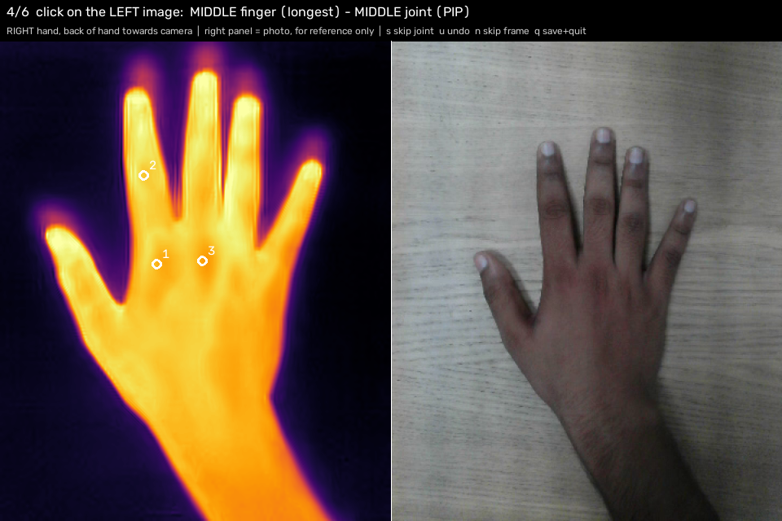
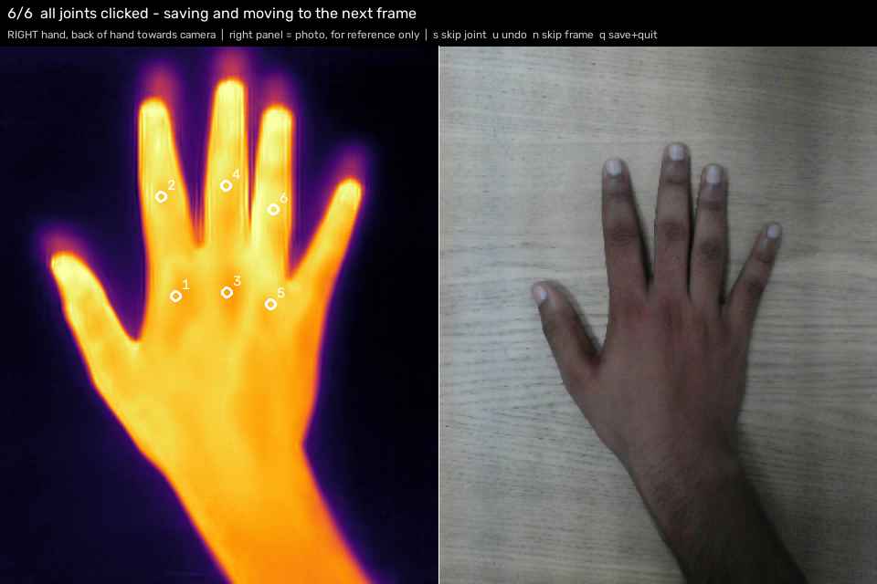

# Annotation guide (RQ2 ground truth)

**Why:** the pipeline maps joints found in the RGB photo onto the thermal image. To prove the mapping
lands on the *real* joints, a person must click the true joint positions on the thermal image.
The analysis then measures the distance between your clicks and the pipeline's joints
(pass if the median error is ≤ 8 px ≈ 2 thermal-sensor pixels).

**Workload:** 68 recordings × 2 frames = **136 frames**, 6 clicks each, about 15–20 s per frame
→ **35–45 minutes**. You can stop at any time with `q` and continue later.

---

## 1. Start the tool

In VS Code, open a terminal in the `rgb_thermal_hand_screening` folder and run:

```powershell
.venv312\Scripts\python.exe -m src.annotate
```

A window opens with two panels:

* **LEFT = thermal image → you click here.**
* **RIGHT = the photo of the same moment → only to help you see which finger is which.**
  (The two are not perfectly aligned; that misalignment is exactly what is being measured.)

The black banner on top always tells you **which joint to click next**.


## 2. Which points to click

Click these 6 joints **in this order**, on the **LEFT (thermal)** image:

| # | Joint | Where it is |
| --- | --- | --- |
| 1 | Index knuckle (MCP) | base of the finger **next to the thumb**, where the finger meets the back of the hand |
| 2 | Index middle joint (PIP) | first bend of that finger, roughly a third of the way up |
| 3 | Middle knuckle (MCP) | base of the **longest** finger |
| 4 | Middle middle joint (PIP) | first bend of the longest finger |
| 5 | Ring knuckle (MCP) | base of the finger after the middle one |
| 6 | Ring middle joint (PIP) | first bend of the ring finger |

Tips
* Find the **thumb** first in the photo. The finger right next to it is the **index**.
  For a **right** hand seen from the back the thumb is on the left; for a **left** hand it is on the right.
  The banner tells you which hand it is.
* Knuckles (1, 3, 5) form a row across the back of the hand. Middle joints (2, 4, 6) form a row
  higher up the fingers.
* Click the **centre** of the joint, across the finger's width.

## 3. Worked example (S2_right_static — not one of your 136 frames)

Halfway through: clicks 1–3 done, the banner asks for click 4.



Finished: all six joints clicked. The tool saves and moves to the next frame by itself.



What was clicked here: **1** base of the index finger (the finger next to the thumb, which is on the
left because this is a right hand); **2** first bend of the index finger; **3**/**4** the same on the
middle (longest) finger; **5**/**6** the same on the ring finger.

## 4. Keys

| Key | Does |
| --- | --- |
| left click (on the LEFT panel) | place the next point |
| `u` | undo the last point |
| `s` | this joint is not visible (bent away, hidden) — skip it |
| `n` | skip the whole frame (e.g. hand is a fist, nothing visible) |
| `q` | save and quit; run the same command again to continue where you stopped |

Clicks on the right panel or on the banner are ignored.

## 5. Made a mistake on an earlier frame?

Note the recording and frame number printed in the terminal (e.g. `S5_left_static frame 78 saved`) and re-do it:

```powershell
.venv312\Scripts\python.exe -m src.annotate --redo S5_left_static:78
```

## 6. When finished

```powershell
.venv312\Scripts\python.exe -m src.analysis
```

Open `reports/results/summary.json` → `RQ2` → `landmark_err_median_px` and `landmark_pass`.
The analysis gives a verdict once at least 80 % of the 816 planned points exist.
Your clicks are in `data/annotations/joints_clicked.csv`.

Do **not** look at `data/processed/qc/*.png` before or while annotating — those show the pipeline's
answer and would bias your clicks.
